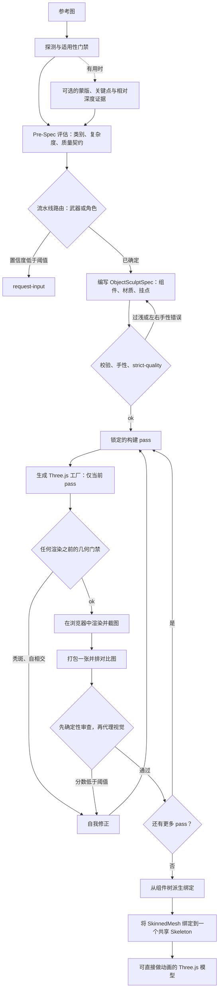

# 架构

img2threejs 的完整机制：分阶段流水线如何运行、为何能保持 token 高效、每个脚本做什么、最终产出哪些产物。[README](../README.md) 介绍定位和快速上手；本文说明它实际如何工作。

---

## 流水线概览

本技能运行一条分阶段的雕刻流水线。脚本为每个阶段设门禁；只有代理的视觉判断能批准一个 pass。



图中有两点容易忽略，二者都是因为纯渲染循环漏掉了它们才加入的。**几何门禁在浏览器之前运行**——秃斑或自相交在点数据上就能发现，因此不会花一个 pass 去渲染本已错误的几何体。**路由可以拒绝**：置信度低于 `0.82` 时，路线解析为 `request-input`，而不是去猜主体是武器还是角色。

### 材质参考交接

材质识别是一条可执行的子流水线，而不是写在 spec 里的散文：

```text
named component region
  -> verified crop + observation
  -> material-reference.json resolver
  -> reference-derived PBR maps and bounded prior
  -> ObjectSculptSpec materialReference/materialPipeline
  -> generated material userData and color-space-safe maps
  -> multi-angle zoom/microscope capture
  -> per-region comparator and bounded feedback
  -> materialGate + material-pass unlock
```

`forge/materials/reference.py` 是运行时注册表契约。注册表从不只凭颜色做决定，含糊或低置信度的区域保持 `probe`/`request-input`。材质门禁还会检查 UV/贴图绑定能否在几何、visual hull、蒙皮、碰撞、morph 和 LOD 变化后保留。没有 `materialPipeline` 的既有 spec 保持向后兼容。

### 构建 pass

模型按固定顺序雕刻；只有上一个 pass 经审查并被接受后，下一个 pass 才会解锁：

`blockout → structural-pass → form-refinement → material-pass → surface-pass → lighting-pass → interaction-pass → optimization-pass`

每个 pass 有各自的验收标准。只有具备真实渲染、对比图、达到或超过阈值的代理视觉分数，且每个决定身份的特征都达到其自身阈值时，pass 才会被标记为 `continue`。

为支持可恢复的工作，`forge/state.py` 围绕这条流水线存储一份原子化的 JSON 检查清单。`character` 和 `cs2` 的 profile 步骤插在本地 spec 编写之前；修正次数按 pass 和全局两级设上限。`forge/next.py --state` 报告下一个有序动作，并拒绝与状态产物不一致的位置参数 spec。该状态索引不授予 pass：仍由 ObjectSculptSpec、渲染证据、审查历史和确定性门禁决定。

### 门禁

- **适用性**——这张图到底能否作为 3D 目标。
- **Pre-spec 与 strict-quality**——在 spec 深度与对象复杂度匹配之前阻止代码生成（复合对象不允许只有单根节点的 spec）。
- **手性**——每一对 `-l`/`-r` 必须是矢状面镜像，而不是旋转副本。旋转会保持手性，所以靠对两个轴取反构建的一对会变成两只同一侧的手。硬门禁，在 spec 阶段执行。
- **头皮暴露（有头发的主体）**——硬门禁，在绘制任何东西之前对几何运行，因为秃斑位于内部，轮廓指标看不到。
- **截图反馈**——`continue` 需要渲染 + 对比图 + 通过的视觉分数，外加分带内部差异：silhouette IoU 只读取约 11% 的人物格子，对删掉脸的模型和完成的模型给出相同分数。
- **可动作（Action-ready）**——模型通过 `root.userData.sculptRuntime` 暴露运行时层级（枢轴、挂点、碰撞体、破坏分组）。
- **连接正确性**——子部件（把手、肢体、管道）声明它们如何连接父级，因此没有东西悬浮在半空。
- **材质与光照真实感**——独立的 PBR 通道和真实光源，绝不把 albedo 混用为 roughness。
- **绑定载荷**——对角色构建，在绑定 `THREE.Skeleton` 之前校验关节/父级/矩阵载荷。它只证明结构完整性；姿态压力和相似度仍是独立门禁。

顺序比清单更重要。凡是能在几何上测量的都在浏览器*之前*运行，因此不会花一个 pass 去渲染已知错误的东西。

### 自我修正

每个 pass 之后，代理恰好选择一个动作：`continue`、`refine-spec`、`refine-code`、`request-input` 或 `stop`。`refine-spec` 修复错误或过浅的 spec 并重新校验；`refine-code` 修复与合理 spec 不符的几何、材质或光照。

---

## 为何 token 高效

大多数图像转 3D 的代理循环靠让模型做机械性工作来消耗 token——每个 pass 重读整个模型、给像素打分、手工校验 JSON、重跑已经做过的步骤。img2threejs 把这些全部推给确定性脚本，只在真正需要判断的地方花模型 token。

- **脚本负责执行，模型负责判断。** Python 脚本处理校验、门禁、spec 编写、PBR 提取、对比图打包和流水线状态。它们从不给视觉效果打分。模型的 token 只用于一件事：看一张并排对比图，决定通过还是失败。
- **零依赖，零安装折腾。** 每个脚本都是纯 Python 3.10+ 标准库。没有 pip、PIL、numpy、Playwright。PNG 读写用 `struct` 和 `zlib` 完成。不需要安装，就不需要在上下文里调试安装。
- **按 pass 门禁生成。** 代码生成器只输出当前已解锁的构建 pass。模型不会在每次迭代时重新生成或重读整个模型——每一步都小而有边界。
- **在 codegen 之前快速失败。** strict-quality 门禁在生成任何一行 Three.js 之前就拦下过浅的 spec，因此你不会花 token 去渲染一个从一开始就描述不足的模型。
- **每次审查只看一张图。** 每个 pass 只依据一张打包好的对比图（参考与渲染并排）判断，而不是一堆零散截图。
- **输出文本，而非二进制。** 结果是可 diff 的 TypeScript 加一个 JSON spec——小、可审查、可版本控制，而不是数 MB 的网格文件。

最终效果：你仍能从一张图得到忠实的 3D 模型，但昂贵的模型上下文只留给视觉判断和代码，而不是簿记。按阶段、按循环的完整 token 拆分见 [TOKEN_COST.md](TOKEN_COST.md)。

---

## 脚本

| 脚本 | 作用 |
| --- | --- |
| `stage1_intake/probe_image.py` | 图像元数据和明显的技术问题（不是视觉检查）。 |
| `stage1_intake/probe_glb.py` | GLB 来源、包围盒、场景清单和保守的语义就绪度评估。 |
| `stage2_spec/new_pre_spec_assessment.py` | 对对象分类、给复杂度打分、输出质量契约。 |
| `stage2_spec/new_sculpt_spec.py` | 根据评估编写 ObjectSculptSpec。 |
| `stage2_spec/validate_sculpt_spec.py` | 校验 spec；`--strict-quality` 在 codegen 之前拦下过浅的 spec。 |
| `stage1_intake/extract_pbr_evidence.py` | 按裁剪区域从参考图得出的 PBR 证据（推断，而非逆向渲染）。 |
| `stage1_intake/material_region_analysis.py` | 区域裁剪准入、PBR 提取和材质参考解析。 |
| `stage2_spec/apply_material_analysis.py` | 把材质分析交接给 ObjectSculptSpec。 |
| `stage3_build/orchestrate_passes.py` | 锁定的 pass 状态：status、check、sync。 |
| `stage3_build/generate_threejs_factory.py` | 为当前已解锁的 pass 输出 Three.js `Group` 工厂。 |
| `stage4_review/make_comparison_sheet.py` | 打包一张参考对渲染的对比图供审查。 |
| `stage4_review/append_review.py` | 记录每个 pass 的审查：分数、决定、证据。 |
| `stage4_review/material_views.py` | 确定性的材质相机/裁剪/显微计划和截取回读校验。 |
| `stage4_review/material_comparator.py` | 按区域的裁剪指标和不匹配标签。 |
| `stage4_review/material_gate.py` | 阻断式材质验收和跨 pass 兼容性门禁。 |
| `stage4_review/validate_render_profile.py` | 校验共享的 GLB/程序化渲染器、相机和六 pass profile。 |
| `stage4_review/compare_region_passes.py` | 比较成对的浏览器诊断 pass，阻止没有依据的逐区域结论。 |
| `stage4_review/cs2_review.py` | 评估阻断式 CS2 刀具审查契约和带版本的场景阈值。 |
| `_shared/feature_acceptance_policy.py` | 强制执行逐特征分数阈值的内部辅助模块。 |
| `stage1_intake/build_detail_inventory.py` | 把参考图切成若干区域并搭建细节清单骨架。 |
| `stage1_intake/extract_landmarks.py` | 叠加关键点网格并为角色搭建 anatomy 块骨架。 |
| `stage1_intake/solve_camera_pose.py` | 输出 reference-camera 块，使渲染能与参考相机对齐。 |
| `stage1_intake/delight_albedo.py` | 在纹理投影前从照片近似得到中性 albedo。 |
| `stage1_intake/run_vision_adapter.py` | 调用可选的隔离 SAM2、MediaPipe 和 Depth Anything 证据适配器。 |
| `stage3_build/bake_projected_texture.py` | 为照片纹理投影输出投影/UV 烘焙描述符。 |

### 角色绑定——`stage5_rig/`（库；检查清单的权威是 plugin-character）

`animated-character` 检查清单步骤和绑定门禁由已安装的 plugin-character（`extract-animated-character`）提供；下列模块仍留在仓库中，作为输出器导入的库（工厂中的 `rig_spec`），也作为带自身测试的参考实现。

| 脚本 | 作用 |
| --- | --- |
| `stage5_rig/rig_spec.py` | 从组件树派生并校验 `RigSpec`，使骨骼不会偏离它们驱动的几何体。 |
| `stage5_rig/geodesic_skinning.py` | 用*穿过实体*测得的距离计算顶点权重；把刚性角色从平滑蒙皮中划分出去。 |
| `stage5_rig/emit_rig.py` | 唯一的顶点权重实现，移植进生成器而不是复制一份。 |
| `stage5_rig/validate_rig_payload.py` | 绑定 `THREE.Skeleton` 之前的阻断式载荷完整性门禁。只证明结构，从不证明姿态或相似度。 |

### 头发

| 脚本 | 作用 |
| --- | --- |
| `stage1_intake/extract_hair_evidence.py` | Otsu 头发/皮肤分割、分带覆盖率、发际线、高光带、发根到发梢的差值。未观察到的视角报告 `notObserved`。 |
| `stage2_spec/hair_profile.py` | 发型 schema 及其校验。发根是头皮 `(u, v)`；绝对坐标的发根是硬错误。 |
| `_shared/scalp_field.py` | 到颅骨的有符号距离，颅骨由头部组件自身的环栈构建。 |
| `stage4_review/scalp_exposure.py` | **硬**门禁：在任何渲染之前在几何上找出秃斑。 |
| `stage4_review/hair_gate.py` | 软门禁：分带覆盖率、发际线和高光偏移。从属于头皮暴露门禁。 |

### 手性、审查与结构

| 脚本 | 作用 |
| --- | --- |
| `_shared/chirality.py` | 用代码表达左右。`check_pair` 捕获旋转得到的一对；`medial_lateral_bias` 捕获两侧以同样方式出错的一对。 |
| `stage4_review/interior_difference.py` | 轮廓*内部*的外观差异，按高度分带。每个视觉 pass 都必须有。 |
| `stage4_review/divine_eye.py` | 确定性多信号渲染评估器；硬门禁加带自身不确定度的软信号。 |
| `stage4_review/vlm_gate.py` | 设门禁、经校准的最后一层。硬门禁失败时从不调用。 |
| `stage4_review/fit_params.py` | 有界、感知门禁的 analysis-by-synthesis 参数拟合。 |
| `stage4_review/self_intersection.py`、`turntable_gate.py`、`attachment_anchor.py`、`joint_loops.py`、`pairwise_penetration.py`、`geometry_integrity.py` | 在几何而非像素上运行的离轴、放置和拓扑门禁。 |
| `stage3_build/visual_hull.py`、`uv_unwrap.py`、`morph_targets.py`、`decimate.py` | 外壳雕刻、UV 展开、blendshape 目标和二次误差减面。 |
| `_shared/pipeline_routing.py` | 失败即关闭的武器/角色路由；置信度低于 `0.82` 时解析为 `request-input`。 |
| `_shared/workflow_state.py`、`state.py`、`next.py` | 可恢复的有序检查清单和下一动作报告器。 |

此表是精选，不是全量清单——`forge/` 约有九十个模块。包含每个参数及每个阈值背后测量的可执行参考是 `grimoire/scripts.md`；逐门禁契约是 `grimoire/review/gates_reference.md`。`grimoire/` 的其余部分存放各门禁所用的评分细则（校验、pre-spec 评估、程序化模式、材质与光照真实感、连接正确性、可动作模型、自我修正）。

---

## 你会得到什么

- 一个 `ObjectSculptSpec` JSON：完整组件树、材质、重复系统、挂点，以及每个 pass 的审查历史记录。
- 一个 TypeScript `createObjectNameModel(spec, options)` 工厂，返回 `THREE.Group`，`root.userData.sculptRuntime` 暴露节点、挂点、碰撞体和破坏分组。
- 对角色构建，`root.userData.rig`：骨骼、一个共享 `Skeleton`、骨骼顺序和索引映射，以及一个经计算而非声称的 `bound` 标志——只有每个蒙皮网格都真正绑定成功时它才为 true。
- 一份渲染和若干对比图，记录每个 pass 的保真度。
