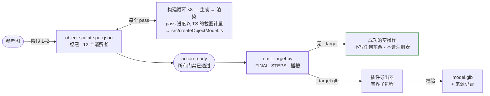
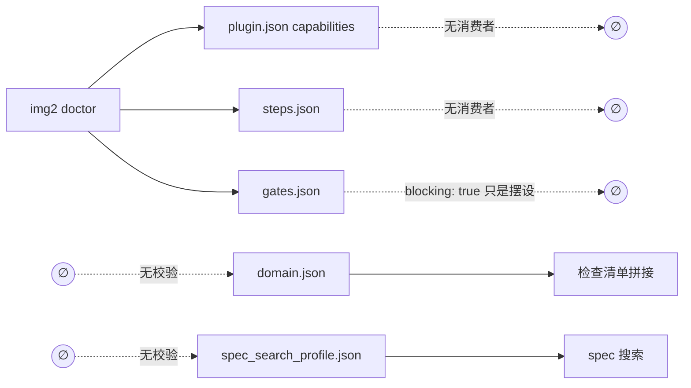
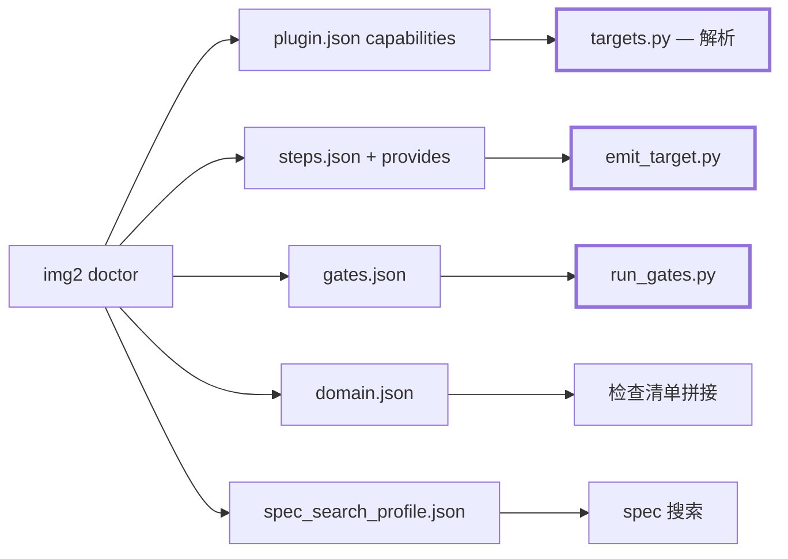
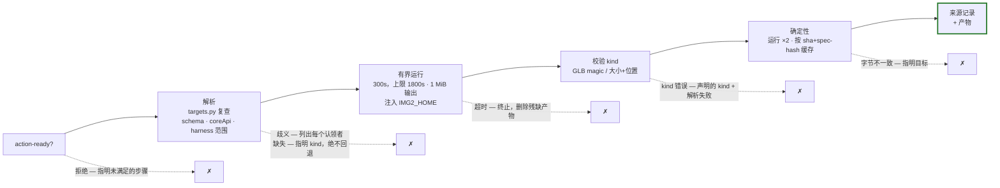
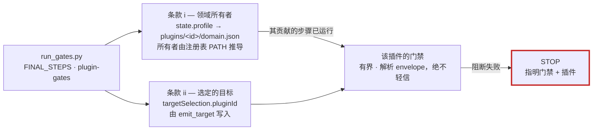

# 输出目标插槽（Emission Target Socket）

流水线的最终导出点。默认输出保持逐字节一致的程序化 Three.js TypeScript；导出器（GLB、FBX……）是用 `--target` 显式选择的已安装插件——基础层零改动，由 sculpt-echo 往返测试的 clean-`git diff` 断言持续证明。契约原文：`img2` PLUGIN_CONTRACT 草案各节和 plugin-wiki Scenario 12。

## 1. 流程——目标是新增，绝不是替换

spec 才是架构真正的分叉点：`object-sculpt-spec.json` 在 `forge/` 中有 12 个非测试消费者，TypeScript 输出器只是其中之一。逐 pass 构建循环不受影响；插槽只在所有门禁都通过后才运行。

没有 `--target` 时，导出步骤是一个**在读取任何注册表之前**就返回的空操作——格式错误的 `plugins.json` 不会破坏默认路径。选择一个目标会在 TypeScript 旁边新增第二个产物；不替换、覆盖或删除任何东西。

## 2. 插件接口——从两个互不相交的半边到一体

PR #106 审查的核心发现：`doctor` 校验的东西没有任何消费者，而驱动运行的东西没有任何校验。

**之前**——虚线边是每个文件生命周期中缺失的那一半：

**之后**——每个声明文件都经过校验，*并且*有具名消费者；两个加粗的消费者是本次变更新建的：

占位符词表**按消费者**封闭，与各渲染器实际替换的内容一致——统一的一套从来都不成立：

| 文件 | 词表 | 渲染器 |
|---|---|---|
| `steps.json` / `gates.json` | `{plugin_dir}` `{workspace}` `{image}` `{spec}` | harness 执行的 argv |
| `domain.json` | `{plugin_dir}` `{reference}` `{spec}` `{pass_id}` | 检查清单 `.format()`——在这里用 `{workspace}`/`{image}` 会 `KeyError` |

Shell 元字符加固适用于命令行（首个 token 是路径或已知解释器）；散文式说明行——cookbook 自己的示例就含有这类行，括号等一应俱全——只做词表检查。

## 3. 插槽内部——每条失败路径都有名字

没有静默回退：*已选择但失败*永远不等于*未选择*。只有后者回退到默认 TypeScript 路径。基础层担保 TypeScript 模型及其门禁；目标产物携带来源记录和目标插件自身门禁的判定，除容器/存在性/大小/位置/确定性之外，不带任何基础层质量担保。

## 4. 门禁执行——两条款参与规则

每个已发布插件的 `blocking: true` 门禁此前从未在任何地方执行过。`run_gates.py` 依据一条可从工作区状态推导出的规则运行它们——绝不靠名称匹配：

未向工作区检查清单贡献任何步骤的插件不运行任何门禁。格式错误的判定 envelope 是错误，绝不算通过；判定声明的状态必须与其退出码一致。

## 为何采用第三种设计

| | 设计 | 为何被否 / 为何成立 |
|---|---|---|
| ✗ | **A — 片段拼接**，在 `generate()` 内部的 8 个锚点处 | AST 显示 8 个锚点中有 7 个不是接缝（一个 1,753 行函数的 711 行分解）；片段是编译后执行的 TS；替换还牵扯出保留的 `overrides` 机制 |
| ✗ | **B — manifest 级目标边** | 方向对，但有两个错误的经济性主张：解析存在但*调用*不存在（没有 `{spec}` 占位符），且基础输出器并不原生符合（退出码 2 被重载、错误路径没有 envelope） |
| ✓ | **C — 步骤行上的 `provides` + 终端插槽** | 使用契约自身记录的升级路径：manifest 边 = *发现*，步骤行 = *调用 + 产物*，是否为目标取决于**用户的查询**；不替换任何东西，因此不需要覆盖机制 |

完整审查记录（5 轮对抗性审查，43+ 条记录在案的决定）：组织工作区中的 `openspec/changes/establish-the-emission-target-contract/review/`。
