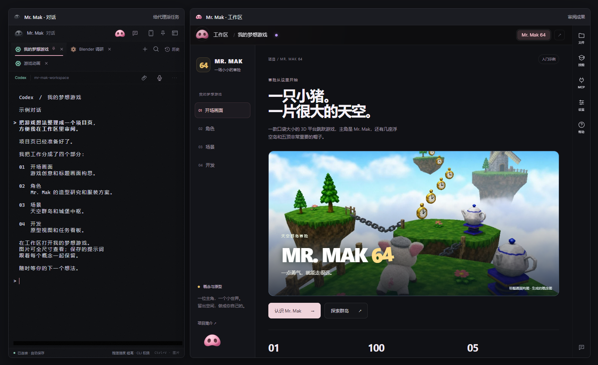
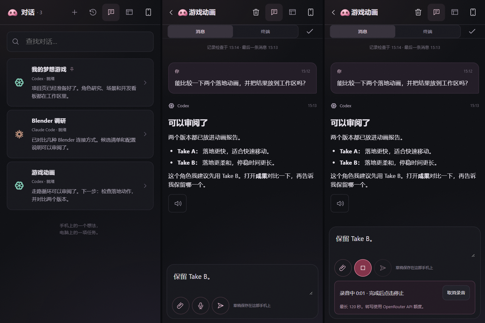
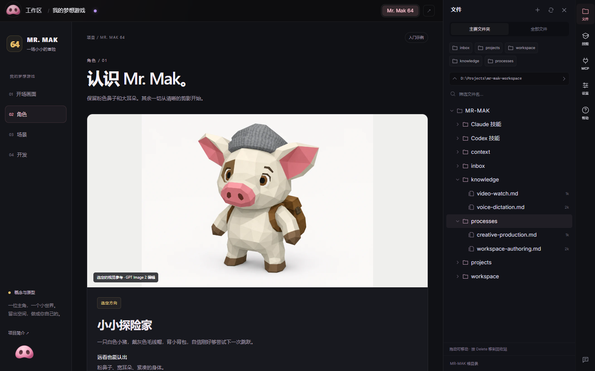
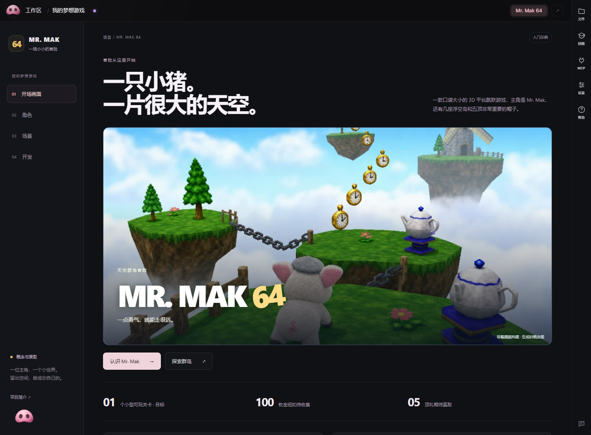

# Mr. Mak Workspace

你的 CLI 代理、可视化工作区，以及手机访问。

Mr. Mak 有**两个联动的桌面窗口**：

- **对话**：把任务交给 Codex、Claude Code、Antigravity、OpenCode 或 Kimi。每个
  对话都在真实的 CLI 终端里运行，有独立的标签页和保存的历史。
- **工作区**：查看成果，包括项目页面、调研、图片、保存的提示词和报告。文件、
  技能、MCP 连接和设置也都在旁边。

两个窗口可以并排摆放，也可以各自独立最小化。在 Blender、游戏引擎或浏览器里
工作时，可以让对话窗口保持可见。

**0.5 新增：[连接手机](#在手机上)**，在代理继续于电脑上工作的同时，跟进同样的
对话、发送想法、语音听写消息。



*左侧为对话，右侧为工作区。应用界面并排摆放，展示示例对话和自带的“我的梦想游戏”项目。*

## 在手机上

通过可添加到主屏幕的移动 Web 应用阅读回复、发送追问或图片、打开工作区报告。
手机经 **Tailscale** 连接到你电脑上的 Mr. Mak。代理继续在电脑上运行，使用
已有的 CLI 账号。

<a href="docs/assets/mobile-overview.png"></a>

*对话列表、单个对话和语音输入的总览。点击图片查看原尺寸。图中为示例对话。*

- **在对话窗口里配对。** 在电脑上点手机按钮，启用手机访问，扫描二维码，并在
  桌面端确认匹配码。
- **从上次中断处继续。** 配对一次后，重新打开同一个手机快捷方式即可。手机和
  桌面可以显示不同的对话，同时共享对话内容。
- **口述草稿。** 点麦克风录音，停止后转写。确认文字后再点“发送”。
- **查看成果。** 放大共享的图片、播放视频，或在保存的位置重新打开报告。可选的
  本地语音可以朗读回复。

保持电脑唤醒并运行 Mr. Mak，两台设备都连接 Tailscale。完成可选的 Python 配置后，
听写可在本地用 Whisper 运行；也可以使用单独计费的 OpenRouter/OpenAI API 额度。
更新会保留当前的提供方。本地听写和朗读不需要转写 API key；可选的 Live 语音协调器
仍按 OpenAI API 计费。

[设置手机访问与语音输入](docs/mobile-access.md)

## 日常工具

- **文件触手可及。** 用“主要文件夹”或“全部文件”浏览文件夹树，快速跳转到
  `inbox`、`projects`、`workspace`、`knowledge` 和 `processes`，并可在 Windows
  资源管理器中打开任意文件夹。
- **可编辑的易读笔记。** 将 Markdown 以排版后的文档打开，切换到“编辑”，在同一
  窗口中保存修改。可在文件树旁预览图片、视频和音频。
- **选择阅读主题。** “设置 > 外观”提供深色、浅色和跟随系统。浅色主题在工作区和
  标准报告中使用白底深色文字。图片保留原色；终端外观单独设置。
- **随时回到的对话。** 在历史中置顶对话，调整标签页顺序和颜色，查看哪些代理正在
  工作、哪些有未查看的回复。把文件或文件夹拖进对话即可插入其路径；剪贴板图片
  保存在 `inbox/attachments`。
- **项目与成果放在一起。** 把调研、设计版本、保存的提示词和动作测试放在卡片内的
  标签页里。图片可原尺寸打开，并可从预览中下载。在桌面应用中，点击卡片的状态
  圆点可修改状态或分类、置顶或归档。可从搜索或“显示归档”中恢复已归档卡片；其
  文件和标签页保持原位。
- **技能与工具随手可用。** 右侧栏可打开项目技能、知识、工作流、MCP 连接、设置
  和帮助。可以看到哪些 MCP 连接来自本项目，哪些来自代理的全局配置。



能力总览见 [Mr. Mak Workspace 能力全景](docs/capabilities.md)。

## 开始之前

**前置条件：在配置 Mr. Mak 之前，先安装并配置好 Codex CLI、Claude Code CLI、
Antigravity、OpenCode 或 Kimi。** 至少需要其中一个。它们可以并存，均为独立安装，
不随 Mr. Mak 附带。

- [安装 Codex CLI](https://developers.openai.com/codex/cli)
- [安装 Claude Code CLI](https://code.claude.com/docs/en/setup)
- [安装 OpenCode](https://opencode.ai/docs/)
- [安装 Antigravity CLI](https://www.antigravity.google/docs/cli/install/)
- [安装 Kimi Code CLI](https://moonshotai.github.io/kimi-cli/)

**需要 API key 吗？** 用符合条件的订阅登录时，Claude Code 或 Codex 对话不需要。
Mr. Mak 运行真实的 CLI 并沿用其现有登录：Claude Pro/Max 可使用 Claude Code，
Codex 可使用 ChatGPT 订阅权限。正常的套餐额度限制仍然适用。API 计费只是备选，
不是必需。参见 [Claude 认证](https://code.claude.com/docs/en/authentication)
和 [Codex 认证](https://developers.openai.com/codex/auth)。

**OpenCode** 使用你在 OpenCode 中配置的提供方与认证。其访问与计费规则照常适用；
这里的支持不会把 Claude Code 订阅变成 OpenCode 的 API 访问。在对话窗口中选择
**+ > OpenCode**。

**Antigravity** 在对话标签页中运行 Google 的 `agy` CLI。按
[官方指南](https://www.antigravity.google/docs/cli/install/) 安装后，选择
**+ > Antigravity**，登录并用 `/model` 选择可用模型。模型访问和用量限制由 Google
控制。历史会恢复该标签页记录的那个对话。Antigravity 在手机上目前使用终端视图；
结构化回复和完成标记暂不可用。

可选的语音协调器明确需要 **Codex CLI** 和你自己的 **OpenAI API key**。语音 API
用量单独计费。不开语音即可在没有 API key 的情况下使用订阅支持的 CLI 对话。

## 让代理帮你开始

在 GitHub 上用 **Use this template** 创建你自己的仓库，然后克隆到你掌控的文件夹。
在已安装的 Codex CLI、Claude Code CLI 或 OpenCode 中打开该文件夹，粘贴：

> 在我的电脑上配置这个 Mr. Mak Workspace 仓库。阅读 AGENTS.md 和
> docs/getting-started.md，检查前置条件，帮我运行 Windows 桌面应用。使用我自己的
> CLI 账号。可选语音、付费提供方、MCP 连接和 Win 键快捷方式先保持关闭，等我
> 决定再连接。把我的凭据放在被忽略的 .env 文件中。给我看四个示例，并帮我换成
> 我自己的项目。

仓库包含示例、说明和应用源码。代理账号和要用的服务由你自己提供。

## 运行桌面应用

Windows：从 [发布版本](https://github.com/witnesstodark/mr-mak-workspace/releases/latest)
下载安装程序，安装 **Mr. Mak Workspace**，然后在克隆的仓库中打开
**Start Mr. Mak.cmd**。Linux：安装 Node、Rust 和 WebKitGTK 前置依赖后构建 Tauri
桌面目标，再用 `--repo /path/to/your/workspace` 启动生成的 AppImage/deb 安装。
macOS：运行 `./setup.sh desktop` 构建 `Mr. Mak Workspace.app`，然后打开
**Start Mr. Mak.command**（[macOS 说明](docs/getting-started.md#macos)）。所有系统上，
都在对话窗口中用 **+** 打开已安装的 CLI，并用你自己的账号登录。

安装程序包含本地 Node 服务，不包含 Codex、Claude Code、Antigravity、OpenCode、
Kimi、Blender、Python 或提供方账号。

**已经在用 Mr. Mak？** 阅读 [0.5.1 更新说明](CHANGELOG.md)，了解 Antigravity、
macOS 改进、移动端导航、本地语音选项和发布安全方面的变化。按
[更新指南](docs/updating.md) 更新应用，并向现有仓库添加技能，而不覆盖你的项目。

从源码构建：安装 Node.js 22.20+ 和 Windows Tauri 构建前置依赖，然后运行：

```powershell
powershell -ExecutionPolicy Bypass -File .\Setup.ps1 -Mode Check
powershell -ExecutionPolicy Bypass -File .\Setup.ps1 -Mode Desktop
```

如需在浏览器中预览报告，用 Node.js 22.20+ 和 npm 运行 `-Mode Preview`。Rust 和
C++ Build Tools 只在编译原生桌面应用时需要；Preview 和下载的安装程序都不需要。
原生桌面应用额外提供托管终端、本地文件操作和语音。完整配置见
[入门指南](docs/getting-started.md)，源码结构见 [架构](desktop/README.md)。

## 包含内容

| 示例 | 演示内容 |
| --- | --- |
| **我的梦想游戏** | Mr. Mak 64：带插画的游戏主页，含开场画面、角色研究、场景和开发看板。 |
| **创意 MCP 连接** | 经过调研的连接候选清单、来源链接和实用配置检查表。 |
| **打造你的工作区** | 入门、日常使用，以及可以让代理帮你做的修改。 |
| **Arachne 角色实验室** | 第 1 到第 9 版、可展开的保存提示词、158 张图片和八段动作研究。 |

示例在你归档前一直可见。可以在旁边创建自己的卡片，准备好后把四个都归档。



终端文字设置可调整可读性。在代理对话中，Ctrl+C 复制选中文字；PowerShell 保持
正常的 shell 行为。点击对话或卡片中的网页链接会用默认浏览器打开。新的 Codex 和
Claude 对话以 `xhigh` 推理强度启动；已保存的推理强度选择会保留。OpenCode 保持
其自身的模型和推理配置。

## 可选的资产交付凭证

资产交付可附带本地 SHA-256 清单。离线的 [资产交付工具](scripts/asset-delivery/README.md)
为卡片记录输入和输出，不修改现有卡片。校验只检查文件完整性；视觉认可和引擎
就绪仍是独立的判断。

## 可长期保留的技能

二十个项目技能覆盖规划、交接、工作区报告、图像参考、fal.ai 生成、Higgsfield
工作流、角色设定图、程序化 Three.js 建模、材质、动作参考、Blender 游戏动画、
视频检查和听写配置。游戏工作流覆盖 **特效（VFX）、UI、动画集成、关卡设计、音频
和原生画面审查**。阅读 [技能索引](docs/skills.md)，或从发布版本中取用单独的技能
ZIP 用到其他项目。

维护中的说明位于 `.agents/skills`。`.claude/skills` 中的完整副本包含相同的说明和
资源。两种代理都能拿到完整技能。编辑维护源后运行 `npm run skills:sync`。复制技能
时连同其引用的资源一起复制；`.env`、任务回执和账号配置保持私有。

## 可选的语音与连接

你完全可以只通过 CLI 对话工作。悬浮的小鼻子提供可选的语音助手：OpenAI Live
通过 API 提供语音连接，协调器使用你已登录的 Codex CLI。语音 API 用量与 CLI 订阅
分开计费。除非在 `.env` 中设置 `MRMAK_COORDINATOR_MODEL`，协调器使用你的 Codex
模型配置。

fal.ai、Higgsfield 及其他提供方均为可选，使用你自己的账号。MCP 配置初始为空。
MCP 面板会说明连接在哪里配置，包括现有代理已有的全局连接。调研示例只是候选
清单，并不表示这些工具已安装。

## 打造你自己的版本

编辑 `context/` 中的占位文件，把可复用的经验放进 `knowledge/`，把工作流保存在
`processes/`。存储内容默认使用简体中文；需要其他语言时随时提出。应用的 Win 键
快捷方式和跳过权限确认默认都是关闭的。

桌面端源码构建支持 **Windows x64、Linux 和 macOS**。Mac 应用未签名；安装前请阅读
[macOS 配置与限制](docs/macos.md)。另见 [自定义](docs/customization.md) 和
[分享你的版本](docs/sharing.md)。

应用代码和原创工作流文档采用 MIT 许可证。附带的第三方技能材料保留其原始许可证。
示例媒体供学习和再创作使用；参见 [第三方声明](THIRD_PARTY_NOTICES.md)。

---

Mr. Mak 很小。


